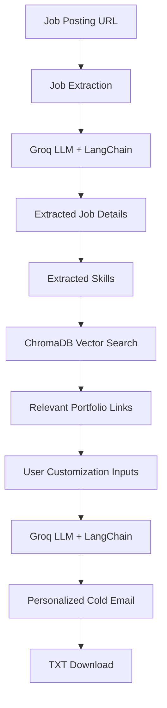

# AI-Powered Cold Email Generator

An intelligent cold email generation application built using **Python, Streamlit, LangChain, Groq LLM, and ChromaDB**.

The application automates the process of creating personalized professional emails by analyzing job postings, extracting relevant skills, and matching them with portfolio entries using semantic search.

Users can customize sender information, company details, email type, tone, and length to generate tailored emails for different job opportunities. Generated emails can also be downloaded as `.txt` files.

---

## Project Overview

Writing personalized cold emails for different job opportunities can be time-consuming. Manually analyzing job descriptions, identifying relevant skills, selecting portfolio projects, and drafting emails requires considerable effort.

This project simplifies that process through an AI-powered workflow.

The application extracts job information from a provided URL, identifies relevant skills, retrieves matching portfolio links using ChromaDB, and passes the collected information to a Groq-powered LLM through LangChain to generate a customized email.

---

## Features

- **Automated Job Extraction:** Extracts relevant job information, including job title, required skills, experience, and job description from job posting URLs.
- **Semantic Portfolio Matching:** Uses ChromaDB vector search to identify portfolio entries relevant to the skills extracted from job descriptions.
- **AI-Powered Email Generation:** Integrates Groq LLM with LangChain to generate context-aware and personalized cold emails.
- **Customizable Email Generation:** Supports dynamic sender details, company name, job role, email type, tone, and length.
- **CSV Portfolio Upload:** Allows users to upload their own portfolio data using a CSV file containing `Techstack` and `Links` columns.
- **Interactive Streamlit Interface:** Provides an interface for entering job URLs and customizing email preferences.
- **Email Export:** Allows users to download generated emails as `.txt` files.
- **Performance Benchmarking:** Includes a benchmarking script to evaluate the execution time of the email generation workflow.

---

## Application Workflow

The application follows a retrieval-augmented generation (RAG)-style workflow, where relevant portfolio information is retrieved before generating the final email.



### Workflow Explanation

1. **Job URL Input:** The user provides a job posting or company URL.
2. **Job Information Extraction:** The application processes the URL and extracts relevant job details using the LLM-based extraction chain.
3. **Skill Identification:** Required technical skills are identified from the extracted job information.
4. **Portfolio Retrieval:** ChromaDB performs semantic similarity search to retrieve portfolio links associated with relevant technical skills.
5. **User Customization:** The user provides sender details, company name, email type, tone, and desired email length.
6. **Email Generation:** LangChain constructs the prompt and invokes the Groq-hosted LLM to generate a personalized email.
7. **Email Export:** The generated email is displayed in the Streamlit interface and can be downloaded as a `.txt` file.

---

## Technology Stack

| Technology | Purpose |
|---|---|
| Python | Core application development |
| Streamlit | Interactive web interface |
| Groq | LLM inference |
| LangChain | Prompt engineering and LLM orchestration |
| ChromaDB | Vector database and semantic portfolio retrieval |
| Pandas | CSV processing and portfolio data handling |
| Python-dotenv | Environment variable management |

---

## Project Structure

```text
cold_email_generator/
│
├── app/
│   ├── main.py                 # Streamlit application entry point
│   ├── chains.py               # Job extraction and email generation logic
│   ├── portfolio.py            # Portfolio management and ChromaDB operations
│   ├── benchmark.py            # Performance benchmarking
│   │
│   └── resource/
│       └── my_portfolio.csv    # Default portfolio dataset
│
├── .streamlit/
│   └── config.toml             # Streamlit configuration (if configured)
│
├── requirements.txt            # Project dependencies
├── .gitignore                  # Git ignored files
├── README.md                   # Project documentation
└── vectorstore/                # Persistent ChromaDB storage (generated at runtime)
```

---

## Installation and Setup

### 1. Clone the Repository

```bash
git clone https://github.com/thiruvayarpadimrudula/cold_email_generator.git

cd cold_email_generator
```

### 2. Create a Virtual Environment

```bash
python -m venv venv
```

Activate the environment.

**Windows:**

```bash
venv\Scripts\activate
```

**Linux / macOS:**

```bash
source venv/bin/activate
```

### 3. Install Dependencies

```bash
pip install -r requirements.txt
```

### 4. Configure Environment Variables

Obtain a Groq API key from the [Groq Console](https://console.groq.com/).

Create a `.env` file in the project root:

```env
GROQ_API_KEY=your_groq_api_key
```

Make sure `.env` is included in `.gitignore` and is never committed to GitHub.

For deployment, configure the API key through your hosting platform's secrets settings using the format expected by the application.

### 5. Run the Application

```bash
streamlit run app/main.py
```

The application will be available at:

```text
http://localhost:8501
```

---

## Usage

1. Open the application in your browser.
2. Enter a job posting URL.
3. Optionally upload a portfolio CSV file.
4. Configure your sender name, company name, and role.
5. Select the email type, preferred tone, and desired length.
6. Generate a personalized cold email.
7. Review the generated email.
8. Download the email as a `.txt` file.

### Portfolio CSV Format

Users can upload a CSV file containing the following columns:

| Techstack | Links |
|---|---|
| React, Node.js, MongoDB | https://example.com/react-portfolio |
| Python, Django, MySQL | https://example.com/python-portfolio |
| Machine Learning, Python, TensorFlow | https://example.com/ml-portfolio |

The `Techstack` column contains the technologies associated with a portfolio entry, while the `Links` column stores its corresponding URL.

---

## Performance Benchmarking

The project includes a benchmarking script to evaluate the execution time of the email generation workflow.

The workflow can be measured across three stages:

- Job information extraction.
- Portfolio retrieval using ChromaDB.
- Email generation using the Groq LLM.

Python's `time.perf_counter()` is used to measure execution time.

The benchmark helps identify performance bottlenecks and provides a basis for evaluating optimization opportunities.

---

## Future Enhancements

- Support for multiple LLM providers.
- Improved portfolio matching using richer project descriptions and metadata.
- Email generation history and saved drafts.
- Additional email templates and customization options.
- Enhanced error handling and URL validation.
- Performance optimization for larger portfolio datasets.

---

## Acknowledgments

This project was initially inspired by the [CodeBasics YouTube tutorial](https://www.youtube.com/c/codebasics).

Further development and customizations include dynamic user inputs, Groq LLM integration, semantic portfolio matching with ChromaDB, customizable email generation, and email export functionality.

**Developed by Mrudula.**